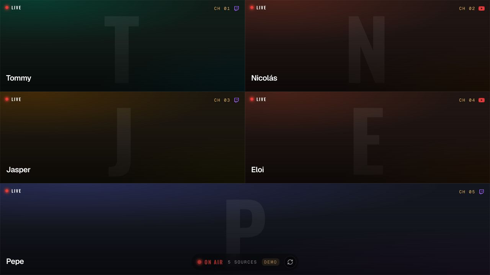
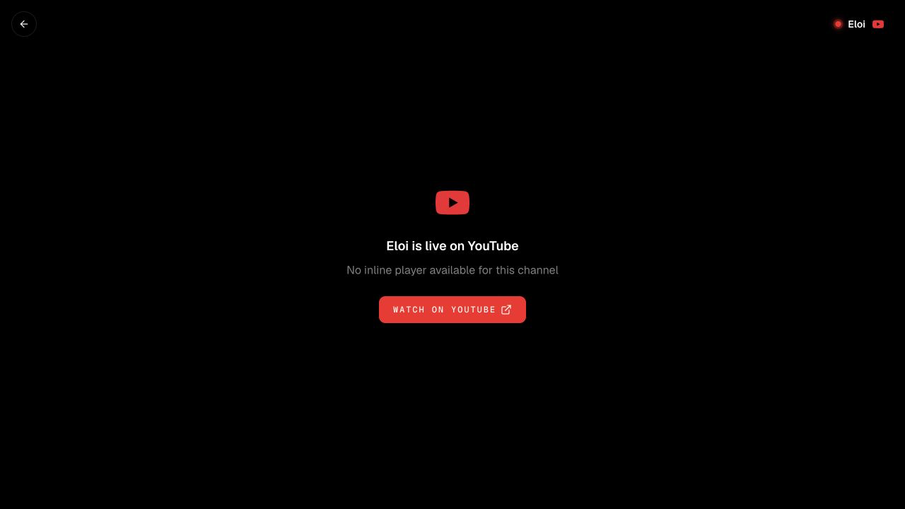
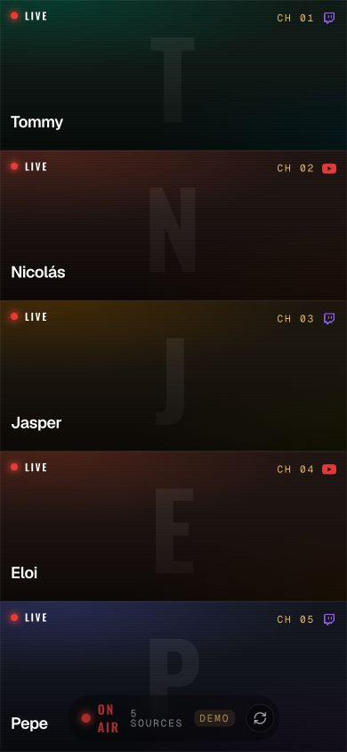

  <h1>StreamGuard Site</h1>
  
A fullscreen live stream wall for servers using the StreamGuard Minecraft plugin.

  
  
  
  

StreamGuard Site is a companion web surface for
[StreamGuard](https://github.com/lutzseverino/minecraft-stream-guard), a
Paper/Spigot plugin that checks whether survival players are live on Twitch or
YouTube.

The site reads the plugin's live feed and turns the current streamers into a
fullscreen broadcast wall. Every live player becomes a screen; selecting a
screen opens the Twitch or YouTube embed.

## Installation

Install [Node.js](https://nodejs.org/) 24 or 26 and pnpm 11, clone this repository, then run `pnpm install` and `pnpm build`. Serve the resulting `dist/` directory alongside the plugin so `/api/live` reaches its HTTP feed.

## Usage

Open the deployed wall in a browser and select a streamer to open the embedded Twitch or YouTube player.

## Screenshots

Captured from the local development demo feed.

| Focused stream | Mobile wall |
| --- | --- |
|  |  |

## Development

See the [development guide](docs/development/README.md) for contributor setup and `pnpm validate`.

## Plugin Feed

The site reads `/api/live`, served by the
[StreamGuard plugin](https://github.com/lutzseverino/minecraft-stream-guard). In local development,
`vite.config.ts` proxies that path to `http://127.0.0.1:8127`.

When the plugin is not running, development builds use a demo feed so the wall remains inspectable.
Production builds expect the real plugin feed.

## Documentation

[Documentation](docs/README.md)

## Contributing

[Contributing](CONTRIBUTING.md)

## License

[GNU General Public License v3.0 only](LICENSE)
